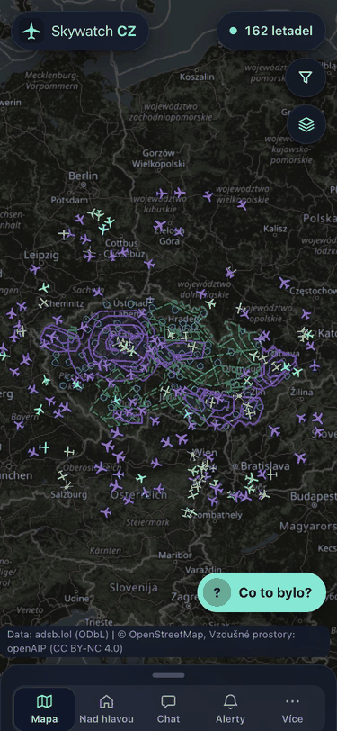
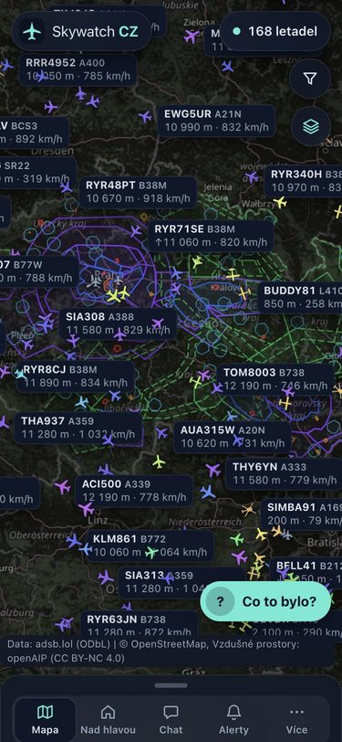
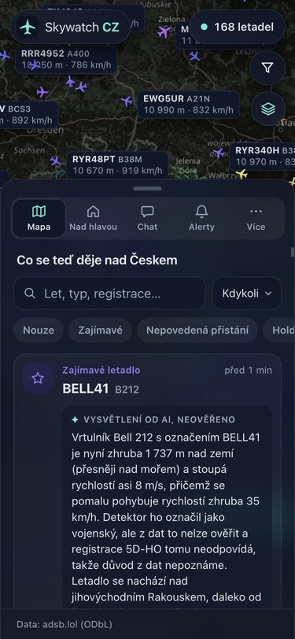
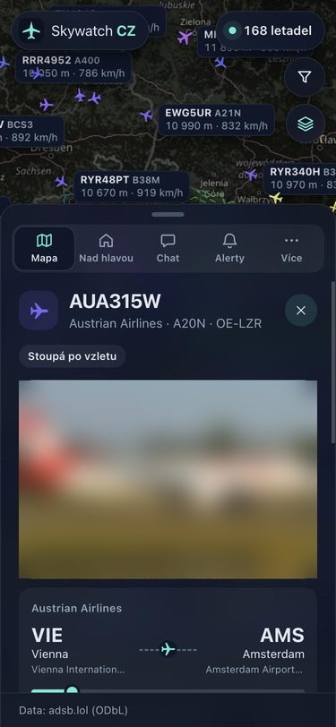
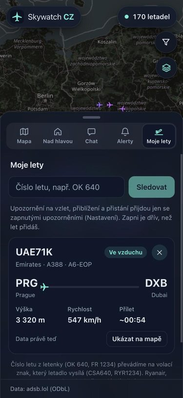
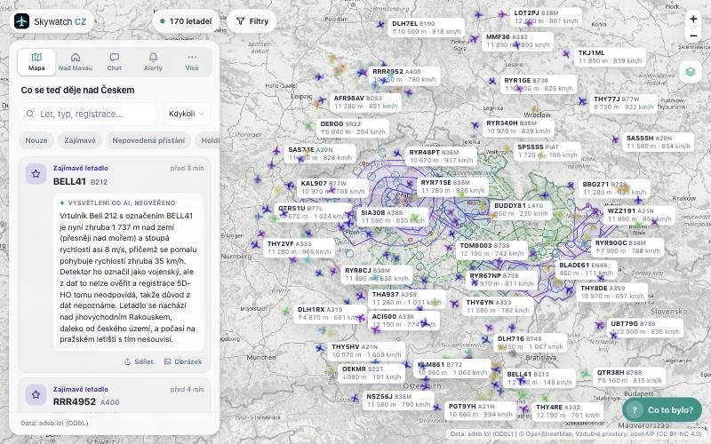

# Skywatch CZ

**A live map of the sky over Czechia that tells you what's actually interesting.** It watches every aircraft
in a 300 km radius, spots the unusual situations (emergencies, go-arounds, holding, rescue helicopters,
celebrity jets), explains them in plain Czech with an LLM that is not allowed to make things up, and pings
your phone when something you asked for in plain words happens.

<p align="center">
  
</p>

> The UI is in Czech (it's built for people in Czechia); code, comments and these docs are in English.
> Data: [adsb.lol](https://adsb.lol) (ODbL). Map: © OpenStreetMap.

## What it does

| | |
|---|---|
| **Live map**: ~170 aircraft updated every 10 s, smooth gliding, icons by kind (airliner, heavy, jet, light, helicopter, glider), data labels that declutter by priority. |  |
| **Event detection**: 8 detectors (emergency squawk, rapid descent, go-around, holding, return/diversion, helicopter orbit, interesting/rare type, watched aircraft), each a pure function with tests. **AI explanations** in Czech (Claude Haiku) that say "we can't tell from the data" instead of guessing a cause. |  |
| **Aircraft detail**: route with progress, flight phase, photo (planespotters.net, credited), registry data, metric units everywhere. |  |
| **Moje lety (flight tracking)**: type "OK 640" or "FR 1234"; the flight is followed worldwide and you get a push on take-off, on approach (with ETA) and on landing. |  |

Also: alerts written in plain language ("let me know when a military plane flies low over Brno") turned
into structured rules by the LLM · Web Push + ntfy notifications · "Nad hlavou" (what's above my house) ·
an AR camera view that labels planes in the real sky and estimates when they disappear behind the horizon ·
"Co to bylo?" (what was that plane a minute ago?) · chat about the current traffic · Prague arrivals/departures
board estimated from ADS-B · 166 watched celebrity, team and government aircraft with visit history
(owners who opted out via FAA LADD/PIA are never shown) · rain radar and airspace layers · weather, noise and
contrail forecast · daily/weekly AI summaries · stats and replay · installable PWA with offline shell and a
battery saver mode.



## Architecture

```
 adsb.lol ──(1 request / 10 s)──► Poller ──► detectors (pure functions) ──► SQLite (events, history)
                                    │                                      │
                                    ├─► listeners: alerts, push, flight tracking, visit history
                                    │                                      │
                                    └─► FastAPI ──► REST + Server-Sent Events ──► React PWA (Leaflet)
                                                     │
                     Claude Haiku ◄── explanations, alert parsing, chat, summaries (capped calls/hour)
```

- **Backend**: Python 3.12+, FastAPI, httpx, SQLite. One poller owns the adsb.lol budget; features plug in as
  listeners instead of editing the ingest loop.
- **Frontend**: React 18 + plain Leaflet (no wrapper library), Vite, hand-written service worker. Mobile first,
  light and dark theme, tested at 375 px and on desktop.
- **Deploy**: Docker Compose + Caddy (automatic HTTPS, token login) on a free Google Cloud e2-micro (1 GB RAM).
  See [docs/deploy.md](docs/deploy.md).

### Engineering notes

- **Polite to the data source.** adsb.lol gets at most one request every 10 s with exponential backoff on 429.
  Tracking a flight outside our area needs a second endpoint, so that lookup *replaces* one area snapshot per
  minute instead of adding a request.
- **Detectors are pure functions** `(track, ctx) -> event | None` with thresholds in YAML, tested on synthetic
  tracks and on recorded real traffic (`replay.py` runs a recording through all of them).
- **The LLM is fenced in.** It gets only the measured data, must say when the cause isn't clear, and every call
  type has a hard cap per hour or day. Units are converted to metric for display only; data stays in ft/kt.
- **Privacy by default.** Aircraft whose owners opted out of tracking (FAA LADD/PIA) are never highlighted,
  alerted on or followed; the watchlist only accepts public figures with a public source.
- **Cheap to run.** The 1 GB server never runs Node: the frontend is built locally and uploaded. Vendor code is
  a separate long-cached chunk and rarely used tabs load on demand (33 kB gzipped app code).

More in [How I built it](docs/how-i-built-it.md).

## Run it locally

```bash
cp .env.example .env          # ANTHROPIC_API_KEY for AI features; everything else works without keys

cd backend
python3 -m venv .venv && .venv/bin/pip install -r requirements.txt
.venv/bin/uvicorn api:app --reload --timeout-graceful-shutdown 2 --port 8000

cd ../frontend
npm install && npm run dev    # http://localhost:5173, /api is proxied to :8000
```

Tests: `cd backend && .venv/bin/pytest` (~250 tests) and `cd frontend && npm test`. CI runs both plus a production
build on every push ([.github/workflows/ci.yml](.github/workflows/ci.yml)).

Developer notes in Czech (fixtures, replay, PWA, configuration): [docs/vyvoj.md](docs/vyvoj.md).

## Data and licences

Aircraft positions: [adsb.lol](https://adsb.lol) (ODbL 1.0) · routes: adsb.lol and [adsbdb](https://www.adsbdb.com) ·
photos: [planespotters.net](https://www.planespotters.net) (shown with credit, not stored) · airports:
[OurAirports](https://ourairports.com) (public domain) · airspace: openAIP (CC BY-NC 4.0) · rain radar: RainViewer · map: © OpenStreetMap
contributors · watched aircraft: [plane-alert-db](https://github.com/sdr-enthusiasts/plane-alert-db) and press sources.
